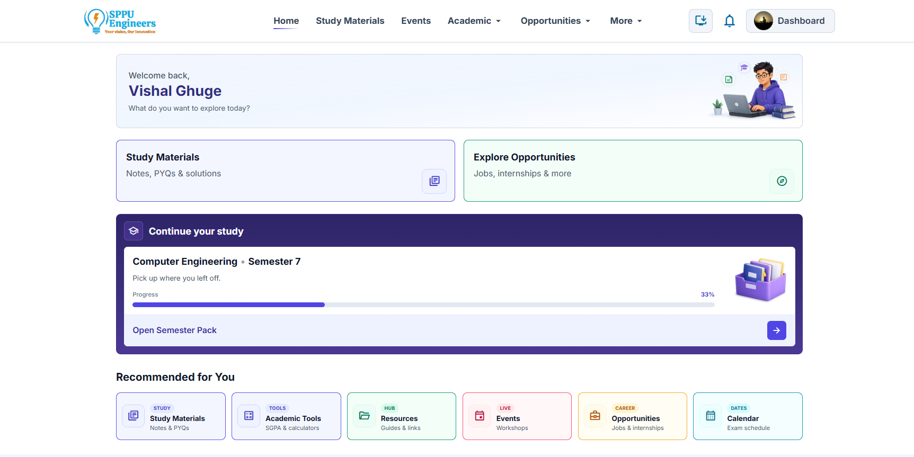
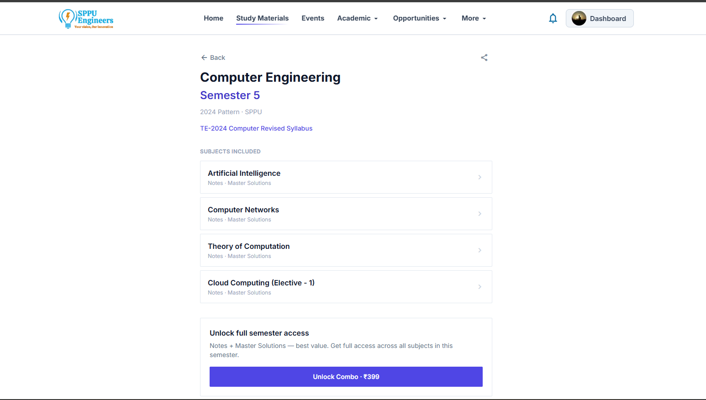
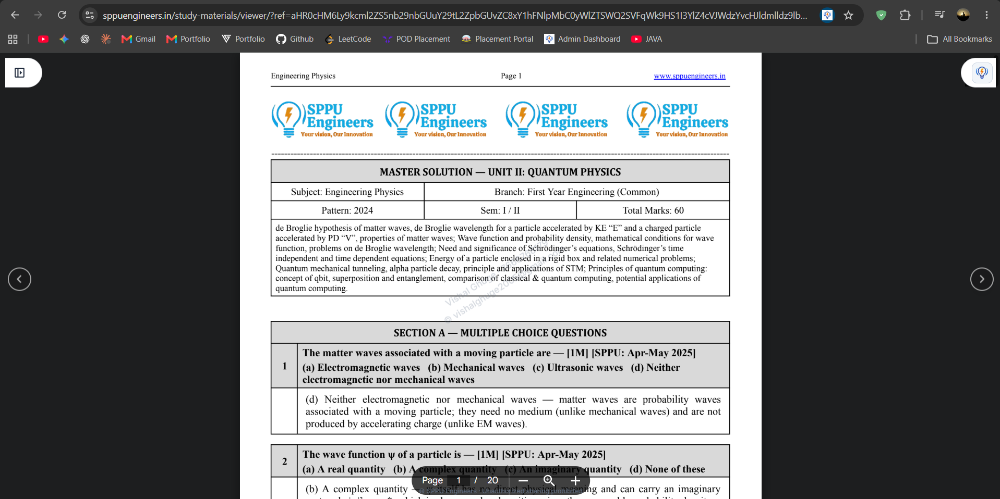
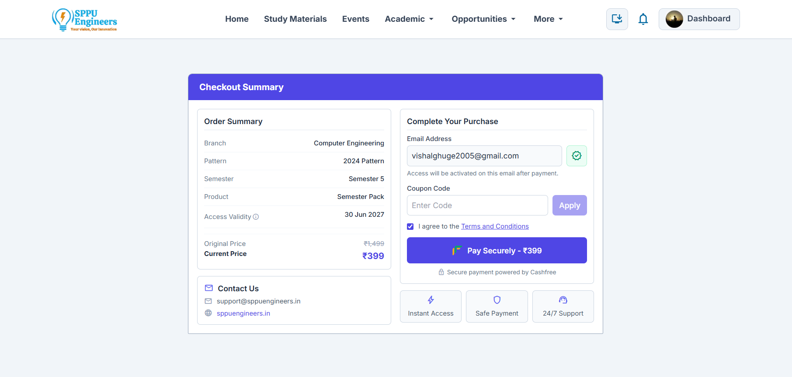
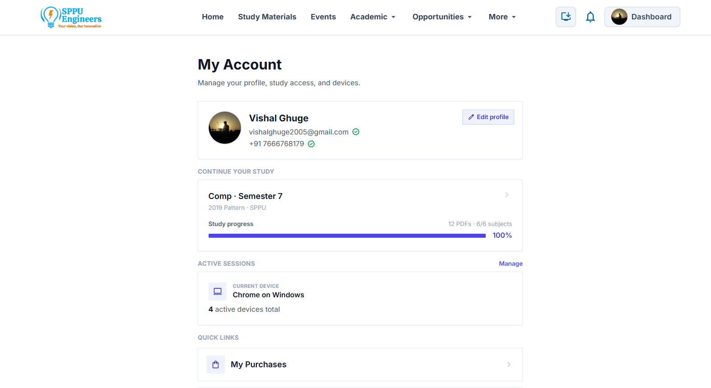
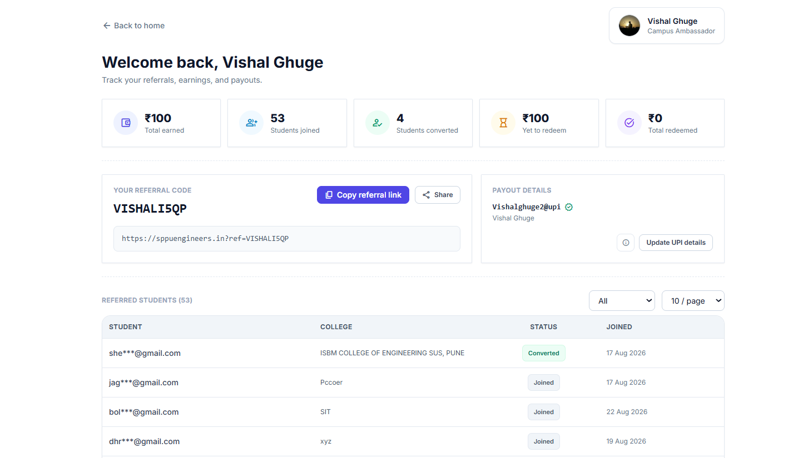
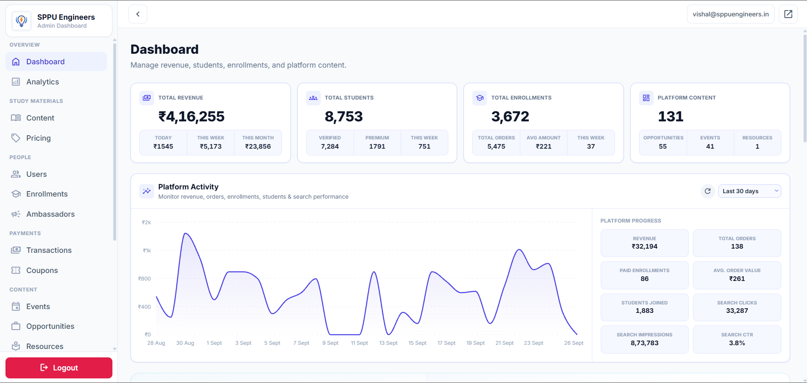
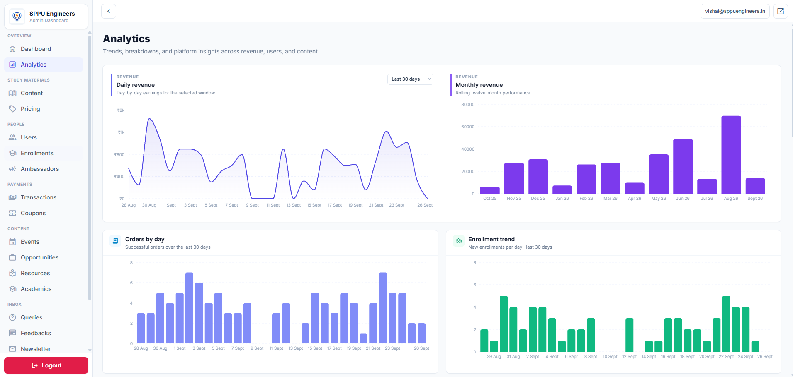
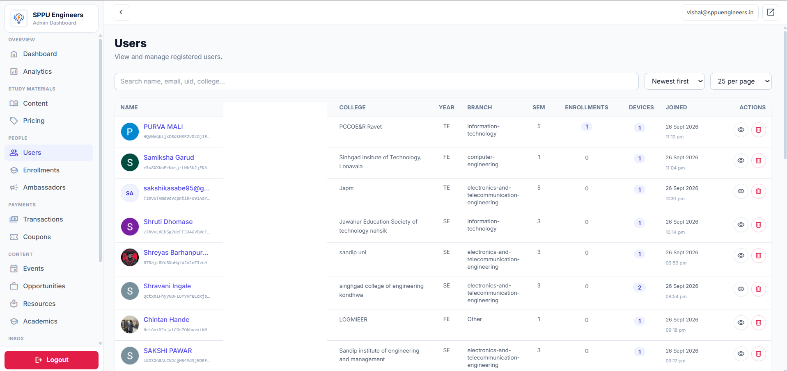
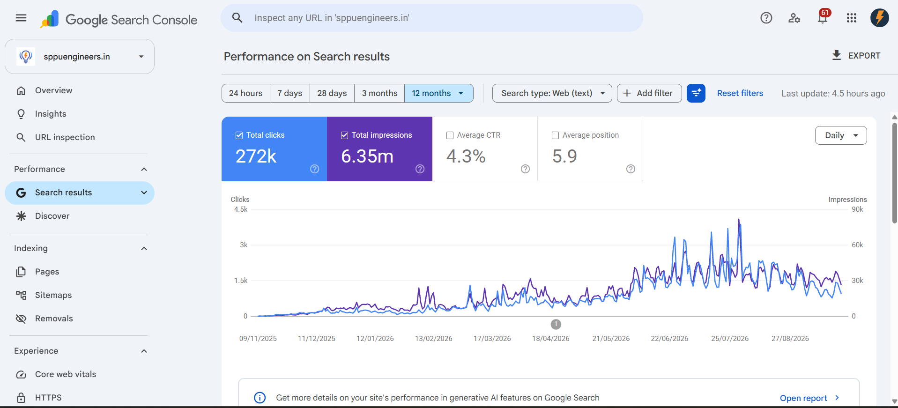

<div align="center">
  
  <h1>SPPU Engineers Platform</h1>
</div>

---

## Introduction

SPPU Engineers is a production ed-tech platform for SPPU engineering students. It puts academic resources, internships and opportunities in one place, across 100+ colleges. Live site: https://sppuengineers.in

Students use it for semester study material, syllabus and exam timetable PDFs, events, jobs, internships, scholarships and SGPA/CGPA calculators. Study material is sold as semester packs, paid through Cashfree. Admins run content, users, payments and analytics from a role-protected panel with 17 sections.

The app is a Next.js 15 project (App Router) with same-origin API routes and a typed service layer over Firebase.

---

## Achievements

| Metric | Value |
|--------|-------|
| Paid enrollments | 3,672+ |
| Revenue | INR 4.1L+ |
| Colleges | 100+ |
| Google Search impressions | 6.35M+ |
| Organic clicks | 272K+ |

---

## Problem

Notes and previous year papers are scattered across Telegram and WhatsApp groups, and there is no single SPPU-focused place for internships, scholarships and events.

SPPU students need study material, previous year papers, syllabus PDFs, events and opportunities that are specific to their university and branch. This platform keeps them in one place, organized by branch, pattern (2019 or 2024) and semester.

---

## Product Walkthrough

### 1. Home Page (Signed-in View)
The home page shows a different view for signed-in users, with featured opportunities and upcoming events.



### 2. Study Materials (Semester View)
Content is organized by branch, pattern, semester and subject. Each semester page shows its subjects and the pack options.



### 3. PDF Viewer with Unit Navigation
The in-app viewer opens a unit and lets the student move to the previous or next unit. Units unlock based on the student's enrollment.



### 4. Checkout and Cashfree Payment Flow
Checkout supports coupons and opens the Cashfree payment modal. The status page polls until the payment resolves.



### 5. Student Dashboard (Purchases and Sessions)
Students see their purchases with access expiry dates, and the devices they are signed in on. Any device can be revoked.



### 6. Campus Ambassador Dashboard
Ambassadors see the students they referred (emails masked), submit UPI payout details and view payout history.



### 7. Admin Dashboard (Revenue and KPIs)
KPI tiles for today, this week and this month, a revenue trend, an activity timeline and a Search Console sync control.



### 8. Analytics (Revenue and Enrollment Trends)
A conversion funnel and revenue breakdowns by product, branch, semester and pattern.



### 9. Admin (User and Enrollment Management)
Server-side search and pagination for users and enrollments, manual enrollment grants, revoke, and per-user device sessions.



### 10. Google Search Console Performance
Search performance data is pulled from the Google Search Console API by a daily cron and shown in the admin panel.



---

## System Architecture

The project was moved from a static HTML/CSS/JS site with a separate Node backend to Next.js 15 (App Router).

```
Browser (React 19 client components)
   |
   |  server-rendered pages, same-origin /api/* route handlers
   v
Next.js 15 on Vercel
   |-- middleware: clean PDF URLs, admin subdomain routing
   |-- Server Components: SEO pages, data loading with unstable_cache
   |-- Route Handlers (Node runtime): payments, auth helpers, admin, stats
   |
   v
Firebase: Auth, Firestore, Storage
External: Cashfree, MSG91, Zoho ZeptoMail, Google Search Console API
```

Rendering split: most files under `src/app` are Server Components. SEO pages load data on the server and pass it to client components as initial content. Auth-gated pages wrap a client view in `RequireAuth` or `RequireAdmin`.

### Payment flow

1. The client calls `POST /api/createOrder` with a Firebase ID token.
2. The server reads the user, the coupon and the price document in parallel. The price comes from a document keyed `pattern__branch__semester__product`. If that document does not exist, the request fails. There is no default price.
3. The server checks coupon total and per-user limits, creates a Cashfree order and writes `payments/{orderId}` as `PENDING` in a transaction.
4. The client opens the Cashfree checkout modal with the returned `payment_session_id`.
5. Confirmation arrives by two paths: the Cashfree webhook, and a polling fallback. The status page polls `GET /api/verifyOrder`. If Firestore still shows `PENDING`, that route asks the Cashfree Orders API for the status.
6. Both paths call the same `fulfillOrder()` function.

Cashfree webhook requests are verified with an HMAC-SHA256 signature check using a timing-safe compare.

`fulfillOrder()` is idempotent. It runs one Firestore transaction with all reads before any writes. It marks the payment `SUCCESS`, creates the enrollment if it does not exist, updates coupon usage and stats, and sets `hasActivePlan` and `enrollmentCount` on the user. Each side effect has a flag on the payment (`statsUpdated`, `couponSuccessCounted`), so a duplicate or late confirmation does not apply it twice. A `FAILED` or `CANCELLED` result never overwrites a `SUCCESS`.

After the transaction commits, the order receipt email (Zoho ZeptoMail) and an optional Google Apps Script call are sent. Both are best effort and do not block the purchase.

### Access expiry

Expiry is computed from the semester and purchase date using SPPU academic cycles and stored as end-of-day IST. There is a test file for it and a migration script.

### Access control for study material

Unit locking is decided in the client by `isUnitAccessible`. The `studyContent` collection holds the Drive links and is readable by any signed-in user, so real access to paid files depends on Google Drive sharing. Syllabus and PYQ PDFs are public and are streamed from Cloud Storage.

---

## Data Model

Firestore is the only database. The server uses the Admin SDK. The browser uses the Firebase JS SDK for reads that the security rules allow. There is no ORM.

| Collection | Purpose |
|------------|---------|
| `users` (subcollection `sessions`) | Profile, role, phone, `hasActivePlan`, `enrollmentCount`, `activeSessionCount` |
| `payments` | One document per order, status, amounts, search fields |
| `enrollments` | Created by fulfillment, with `expiresAt` |
| `enrolled-students` | Legacy enrollments, admin only |
| `coupons` | Code as document id, limits, usage counters |
| `pricing` | One document per pattern, branch, semester and product |
| `studyContent` | Subjects and units per semester |
| `studyProgress` | Per-user progress |
| `academicDocuments`, `events`, `opportunities`, `resources`, `updates`, `notifications` | Public content |
| `feedbacks`, `contact_queries` | Form submissions, admin read |
| `ambassadors` (subcollection `payouts`), `referrals` | Campus Ambassador program |
| `stats/*` | Dashboard and analytics counters |
| `settings`, `newsletters`, `mailRateLimits` | Server-only |

There are 23 composite indexes in `firestore.indexes.json`, covering payments, enrollments, events, opportunities, resources, feedbacks, contact queries and notifications.

Study PDFs, resource files, academic documents and uploaded images are in Firebase Storage.

### Security rules

- A user can create their own document only with `role: "user"`, no phone and `hasActivePlan: false`.
- A user cannot change their own `role`, `email`, `phone`, `mobileVerified`, `hasActivePlan`, `enrollmentCount`, `activeSessionCount` or `createdAt`.
- An ambassador can only write their UPI fields, can only set `upiStatus` to `pending`, and `upiSubmittedAt` must equal the request time.
- A referral document is created once by the referred student. The rules block self-referral and check that the ambassador code matches.
- `payments` and `coupons` are admin only. Any collection without a rule is denied by a default-deny catch-all, so only the Admin SDK can use it.
- The rules have an emulator test suite (`npm run test:firestore-rules`).

---

## Backend Architecture

The backend is 54 Next.js Route Handlers under `src/app/api`, all on the Node runtime. Firebase Admin is initialized lazily, so `next build` works without admin credentials.

Authentication
- Google sign-in (popup, with a redirect fallback), email magic link, and mobile OTP.
- Admin login uses email and password on a separate page.
- API calls carry a Firebase ID token as a Bearer token.
- Magic links are generated on the server and sent through ZeptoMail. The response is always the same, so it does not reveal whether an account exists. There is a 60 second cooldown per email and IP.
- Mobile OTP is generated on the server and sent and verified through MSG91. The server checks the phone number is not used by another account before saving it.
- Each login registers a device session under `users/{uid}/sessions`. A student can revoke any device.
- Raising a session version setting signs all users out once.

Admin role
- There is one role: `users/{uid}.role == "admin"`. The API checks it in `verifyAdmin`, the Firestore rules check the same field, and the admin pages are wrapped in `RequireAdmin`. There are no custom claims.
- Some admin routes also accept an `x-admin-token` header.

Middleware
- Rewrites clean syllabus, PYQ, resource and academic document URLs to path-based API handlers.
- On production, `sppuengineers.in/admin/*` redirects to `admin.sppuengineers.in`. The admin host is served with `noindex, nofollow`. Localhost, `dev.sppuengineers.in` and `*.vercel.app` skip this routing.

Admin panel (17 sections)
The sections, by group:
- Overview: Dashboard, Analytics
- Study Materials: Content, Pricing
- People: Users, Enrollments, Ambassadors
- Payments: Transactions, Coupons
- Content: Events, Opportunities, Resources, Academics
- Inbox: Queries, Feedbacks, Newsletter, Notifications
- System: Settings

Stats and analytics
- Counters are incremented in the same transactions as the business writes. They are stored in `stats/dashboard` and `stats/sales`, plus daily, weekly, monthly and yearly buckets keyed by IST date. Breakdowns cover product, branch, semester, pattern, payment method and coupon.
- `GET /api/admin/stats` returns one bundle. Headline numbers come from live Firestore `count()` and `sum()` queries. Time series come from the stored buckets. The result is cached in memory for 60 seconds.
- Scripts exist to rebuild and verify the stats (`rebuild:stats`, `verify:stats`, `validate:aggregation`, `verify:ui`).

Admin search and pagination
- Firestore cannot search inside strings. Writes to users, payments and enrollments also store lowercase copies of fields and a `searchTokens` array (up to 40 tokens). Queries use prefix ranges and `array-contains-any` with at most 10 tokens. A backfill script fills older records.
- Pagination uses cursors: fetch `pageSize + 1` documents, then `startAfter`. Totals use `count()`.

Campus Ambassador program
- A student who signs up with an ambassador code gets a `referrals` document with status `signed_up`. On the student's first enrollment, `fulfillOrder()` sets it to `converted` inside the same transaction.

Cron
- One cron is configured in `vercel.json`: `/api/cron/gsc-sync` at `0 4 * * *`. It syncs Google Search Console data.

---

## Performance

- Server caching with `unstable_cache`: published events and opportunities for 300 seconds, resources, academic documents and study content for 60 seconds.
- ISR with `revalidate = 60` on the syllabus and exam timetable pages.
- Static generation with `generateStaticParams` for study material, legal and first year subject pages.
- PDFs stream from Cloud Storage with `Readable.toWeb` and are not buffered in memory. Responses use `Cache-Control: public, max-age=3600`.
- The admin charts and the viewer load lazily through `next/dynamic`.
- The Cashfree SDK is preloaded when the checkout page mounts.
- Client caches in `sessionStorage` and `localStorage` for auth, study access, home feed, semester pricing and study progress.
- A `StaleChunkRecovery` provider handles failed chunk loads after a deploy.
- `enrollmentCount` and `activeSessionCount` are stored on the user document, so the admin users list needs no extra reads.
- PWA: a hand-written service worker caches an offline page and icons. It does not cache `/_next/` or `/api/`. There is a manifest and an install page.
- SEO: metadata in 74 route files, JSON-LD in 27 files, a generated `sitemap.ts` and `robots.ts`, and `trailingSlash: true` to keep the old URLs.

---

## Tech Stack

- Next.js 15 (App Router)
- React 19
- TypeScript
- Tailwind CSS
- Firebase Auth
- Firestore
- Firebase Storage
- Cashfree Payment Gateway
- MSG91 (SMS OTP)
- Zoho ZeptoMail
- Google Search Console API
- Recharts
- Vercel

State is held in React Context and custom hooks. There is no Redux, Zustand or React Query. The animation library is `@lottiefiles/dotlottie-react`.

---

## Deployment

- Hosted on Vercel. Hosts used by the code: `sppuengineers.in` (site), `admin.sppuengineers.in` (admin), `dev.sppuengineers.in` and `*.vercel.app` (non-production).
- Firestore rules and indexes are deployed with the Firebase CLI. Rules tests run against the Firestore emulator on port 8098.

---

## Documentation

- [docs/architecture.md](docs/architecture.md): structure of the app and the request paths
- [docs/modules.md](docs/modules.md): what each part of the codebase does
- [docs/data-flow.md](docs/data-flow.md): payment, sign-in and stats flows
- [docs/apps-script.md](docs/apps-script.md): the optional Google Apps Script call after payment
- [docs/scaling.md](docs/scaling.md): how reads, writes and caching are kept small
